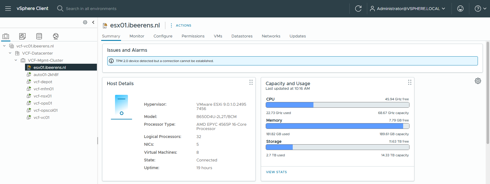
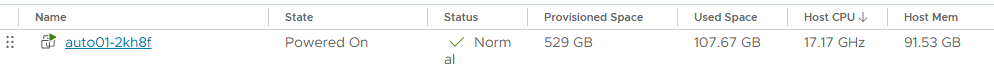

# Introduction

In my home lab,

On my new home lab environment which contains a single server 
VCF 9
json
NFS

After the deployment 35 GHz and 182 GB of memory is used. 

The Automation is a resource killer . After the initial deployment of VCF 9 it uses 17 Ghz en 91 GB of RAM.

