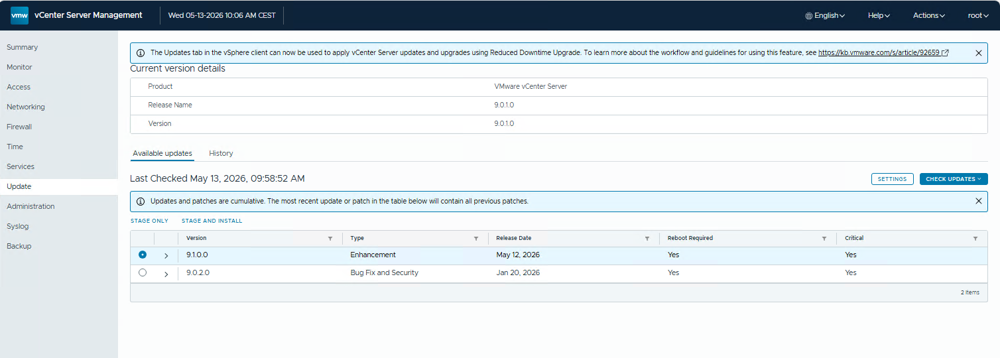

# Introduction

In my home lab, I have a single node environment with a vCenter Server appliance. The vCenter Server appliance is still 9.0.1.0. 

`https://dl.broadcom.com/<TOKEN CODE>/PROD/COMP/VCENTER/vmw/8d167796-34d5-4899-be0a-6daade4005a3/9.1.0.0/`

