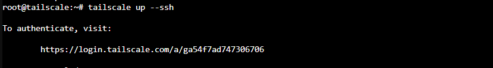

# Introduction


root@pve02:/etc/pve/virtual-guest# pct start 102
vm 102 - lxc.cgroup.devices.allow is deprecated, this will be a hard error in the future!

lxc.cgroup2.devices.allow: c 10:200 rwm
lxc.mount.entry: /dev/net/tun dev/net/tun none bind,create=file

pct start 102

apt update -y
apt upgrade -y

apt install curl -y

curl -fsSL https://tailscale.com/install.sh | sh

tailscale up --ssh



root@tailscale:~# ls -la /dev/net/tun
crw-rw-rw- 1 nobody nogroup 10, 200 Nov  5 13:08 /dev/net/tun

Turn IP forwarding in the container

pct enter <CTID>
```
echo 'net.ipv4.ip_forward = 1' | tee -a /etc/sysctl.d/99-tailscale.conf
echo 'net.ipv6.conf.all.forwarding = 1' | tee -a /etc/sysctl.d/99-tailscale.conf
sysctl -p /etc/sysctl.d/99-tailscale.conf
```

Advertise the subnets
`tailscale up --advertise-routes=192.168.250.0/24,192.168.10.0/24 --reset`

3. Approve the routes

Go to the Tailscale admin console, open Machines, find the container, then ⋯ → Edit route settings and tick the subnets.

5. On the users’ devices
Windows, macOS, iOS and Android: subnet routes are accepted automatically.
Linux: they need to run:
tailscale up --accept-routes

troubleshoot

`tailscale status`

`ip -s link show tailscale0`


Run it twice and compare the RX/TX counters. For a live view:
`apt install -y iftop`
`iftop -i tailscale0`

Check the Tailscale daemon’s logs
`journalctl -u tailscaled -f`
