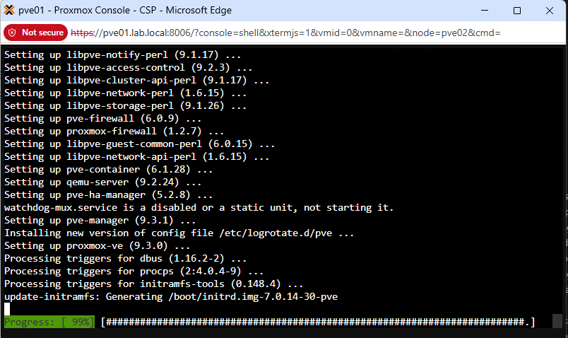
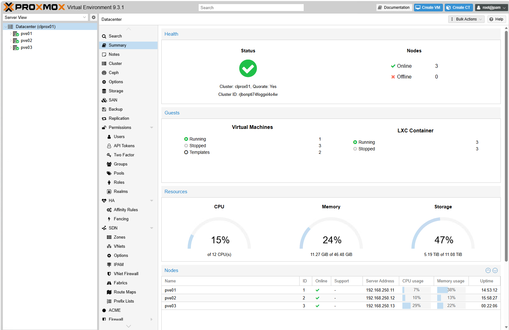

Proxmox VE 9.3 was released yesterday. I upgraded my 3-node homelab cluster the same evening, and in this post I'll share what stood out in this release and the steps I took.

## What's new and what matters

The full list is in the [release notes](https://pve.proxmox.com/wiki/Roadmap#Proxmox_VE_9.3). These are the changes I think are worth your attention:

**SAN support keeps getting better.** There is now a cluster-wide multipath and SAN view for iSCSI, Fibre Channel and NVMe-oF, and thick-provisioned LVM supports snapshots as volume chains. At customers moving away from VMware, the question I get most is "can we keep our existing SAN?" Lack of snapshots on shared LVM was a real blocker. This release closes a big part of that gap.

**HA maintenance mode in the GUI.** You can now put a node in maintenance mode from the web interface. HA-managed guests are migrated off automatically and moved back when you disable maintenance mode. Before, this was a CLI-only job (`ha-manager crm-command node-maintenance`). It's exactly what you want for a rolling upgrade like this one.

**Kernel 7.3 as opt-in.** The default kernel stays on the 7.0 series. Kernel 7.3 is available if you need newer hardware support. More on that below.

Other changes: bond and VLAN configuration in the installer (handy for remote installs where the management network is on a tagged VLAN), unique guest identities for VMs and containers, nested notification match rules, dedicated VRFs for SDN Simple zones and Ceph Tentacle 20.2 as the stable default.

## My lab

My homelab is a 3-node cluster (`clprox01`) built on second-hand Dell OptiPlex 3050 Micro machines. They're cheap, quiet and use little power, which is exactly what you want for something that runs 24/7. The cluster runs Home Assistant and a set of containers for other services at home, so it's not just a test lab. If it goes down, the house notices. Each node has:

| Component | Spec |
|-----------|------|
| CPU | Intel Core i5-7500T (4 cores, 35W TDP) |
| Memory | 16 GB |
| Boot disk | 128 GB SSD |

The SSD only holds the Proxmox installation. All VMs and containers live on an NFS share on my NAS. Because the storage is shared, live migration only has to copy a VM's memory and not its disks, so moving workloads between nodes takes seconds. That makes a rolling upgrade like this one painless.

<!-- TODO: add a cropped screenshot of the Datacenter > Summary view only -->
<!--  -->

## The upgrade

Going from 9.2 to 9.3 is a point release within Proxmox VE 9, so there is no major upgrade procedure or checker script. It's a normal package update. In a cluster, I still treat it as a rolling upgrade: one node at a time, and the next node only when the cluster is healthy again.

### Before you start

- **Backups.** Make sure you have a recent backup of your guests. <!-- TODO: PBS? -->
- **Repository.** Check which repository you are on (enterprise or no-subscription) in *Node > Updates > Repositories*.
- **Free space.** The update needed about 1 GB on the root disk.
- **Ceph.** If you run Ceph, check that `ceph -s` reports `HEALTH_OK` before each node.
- **Firewall automation.** 9.3 has stricter validation of firewall rules. The API now rejects some rules it accepted before, for example ICMP rules with a list, a range, a service name or a leading zero as ICMP type, and references to security groups with names longer than 18 characters. If Terraform, Ansible or another tool manages your firewall rules, run it once against the first upgraded node before you continue with the rest. See *Known Issues & Breaking Changes* in the [release notes](https://pve.proxmox.com/wiki/Roadmap#Proxmox_VE_9.3).

### Step 1: Check the cluster status

With three nodes, the cluster needs two votes for quorum. That means you can safely take one node down at a time, but never two. Check that all nodes are online and the cluster is quorate:

```
root@pve03:~# pvecm status
...
Votequorum information
----------------------
Expected votes:   3
Highest expected: 3
Total votes:      3
Quorum:           2
Flags:            Quorate

Membership information
----------------------
    Nodeid      Votes Name
0x00000001          1 192.168.250.11
0x00000002          1 192.168.250.12
0x00000003          1 192.168.250.13 (local)
```

### Step 2: Move the workloads

Check what is running on the node:

```
qm list | grep running; pct list | grep running
```

Live-migrate the VMs to another node, or use the new HA maintenance mode to let HA do it for you. Containers can't be live-migrated. They move by restart migration: the container is shut down, moved and started again on the target node. Proxmox waits up to 180 seconds (the default `--timeout`) for the container to stop, so one slow-stopping container can add minutes to the upgrade time of a node. Find out beforehand which containers are slow to shut down, and plan for them.

<!-- TODO: describe what you actually did: migrate manually / maintenance mode / shut down? -->

### Step 3: Check the current version

```
root@pve03:~# pveversion
pve-manager/9.2.26/41a0e2e09b9e6f9d (running kernel: 7.0.14-28-pve)
```

### Step 4: Update the packages

```
apt update && apt full-upgrade
```

Always use `full-upgrade` (or `dist-upgrade`) on Proxmox, never a plain `apt upgrade`, as that can hold back packages that need new dependencies. I also skip the `-y`: on a hypervisor I want to see what's coming before I confirm.

On my node this resulted in 69 package upgrades and 10 new packages, a 237 MB download:

```
Installing dependencies:
  kpartx       libsgutils2-1.48  nvme-cli                             pve-notify-worker  sg3-utils-udev
  libnvme1t64  multipath-tools   proxmox-kernel-7.0.14-30-pve-signed  sg3-utils          uuid-runtime

Summary:
  Upgrading: 69, Installing: 10, Removing: 0, Not Upgrading: 0
  Download size: 237 MB
  Space needed: 1052 MB / 33.2 GB available
```

Note the new dependencies: `multipath-tools`, `nvme-cli` and `sg3-utils` are now pulled in. That's the new SAN and multipath view at work. If you don't use a SAN, you can ignore them.



During the install you'll see the message `watchdog-mux.service is a disabled or a static unit, not starting it.` This is harmless. The watchdog is only started when HA needs it.

<!-- TODO: how long did the install take per node? -->

### Step 5: Reboot and verify

The update includes a new kernel (7.0.14-30), so reboot the node:

```
reboot
```

After the reboot, check the version:

```
root@pve03:~# pveversion
pve-manager/9.3.1/4cbab754a7da645d (running kernel: 7.0.14-30-pve)
```

Then check `pvecm status` again and wait until the node is back in the cluster before you continue with the next one. Do a hard refresh (Ctrl+F5) in your browser as well. The web UI is cached, and after an upgrade an old cached version can give strange errors.

Repeat steps 1 to 5 for the other nodes, and migrate the workloads back when you're done.

## Opting in to kernel 7.3

As you can see in the output above, the node is still running a 7.0 kernel after the upgrade. Kernel 7.3 is opt-in:


`apt install proxmox-kernel-7.3`

```
root@pve03:~# apt install proxmox-kernel-7.3
The following package was automatically installed and is no longer required:
  pigz
Use 'apt autoremove' to remove it.

Installing:
  proxmox-kernel-7.3

Installing dependencies:
  proxmox-kernel-7.3.6-1-pve-signed

Summary:
  Upgrading: 0, Installing: 2, Removing: 0, Not Upgrading: 7
  Download size: 122 MB
  Space needed: 720 MB / 32.0 GB available

Continue? [Y/n]
```

Perform a reboot after the kernel upgrade

`reboot`


I'd only do this if you need it, for example for newer hardware. If something breaks, you can select the previous kernel in the boot menu or pin it with `proxmox-boot-tool kernel pin`.

<!-- TODO: did you try 7.3? Any results? Otherwise remove this section or keep it short -->

## Conclusion

<!-- TODO: adjust with your actual experience and timings -->
A smooth point upgrade: about couple minutes per node, and no downtime for the VMs thanks to live migration. For a homelab, HA maintenance mode in the GUI is a nice quality-of-life improvement. For customers coming from VMware with an existing SAN, the multipath and LVM snapshot improvements are the real story in this release.


